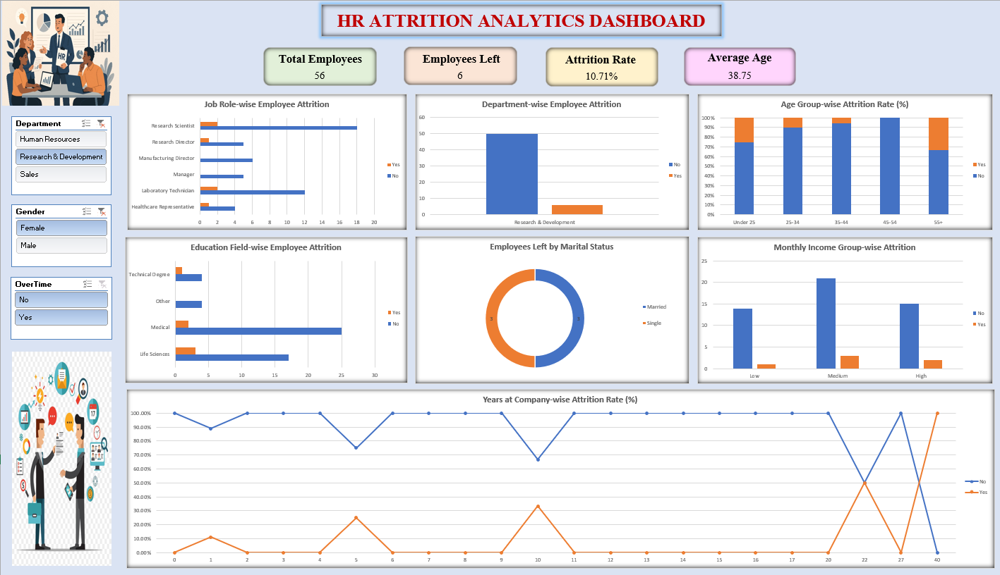

# HR Attrition Analytics Dashboard using Microsoft Excel

## Project Overview
This project is an HR Attrition Analytics Dashboard created using Microsoft Excel.

The main purpose of this project is to analyze employee data and understand employee attrition.

## Tools Used
- Microsoft Excel
- Pivot Tables
- Pivot Charts
- Slicers
- Excel Formulas

## Dashboard KPIs
- Total Employees: 199
- Employees Left: 30
- Attrition Rate: 15.08%
- Average Age: 37.42

## Dashboard Features
- Department-wise Employee Attrition
- Job Role-wise Employee Attrition
- Age Group-wise Attrition Rate
- Education Field-wise Attrition
- Monthly Income Group-wise Attrition
- Marital Status Analysis
- Years at Company-wise Attrition Rate
- Interactive Slicers

## Key Learning
- Data Cleaning
- Data Analysis
- Pivot Tables and Pivot Charts
- Dashboard Creation
- Data Visualization

## Dashboard Preview

## Created By
Onkar Talekar
